

# TourSplit

### Split the costs, keep the memories.

 

  

---

## Overview

**TourSplit** is a modern, privacy-focused travel companion and expense-splitting application. Whether you are trekking remote mountains without cellular reception or traveling across cities with your group, TourSplit keeps your tour expenses, settlements, and conversations perfectly synchronized.

---

## Screenshots

### Modern Interface & Navigation

| Symmetrical Home | Tour Dashboard | Collapsible Tours | Profile & Updates |
|:---:|:---:|:---:|:---:|
| 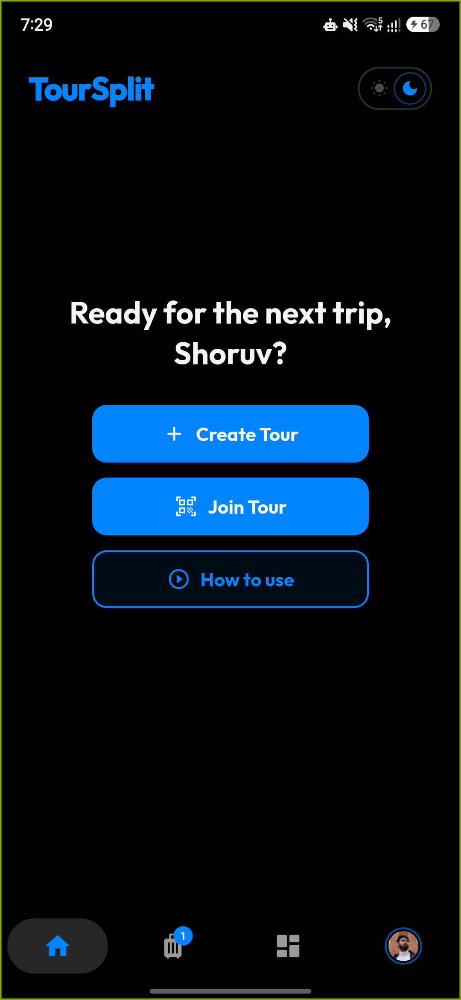 | 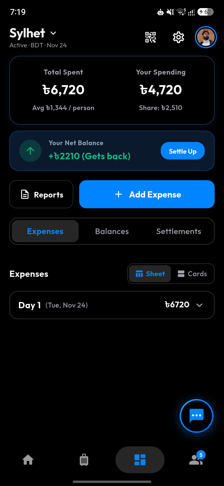 | 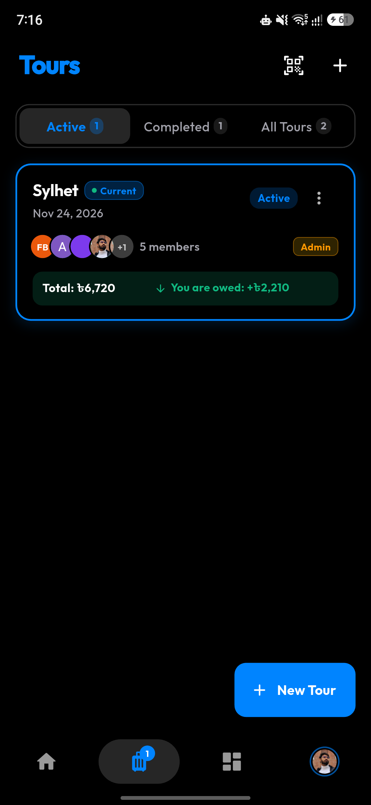 | 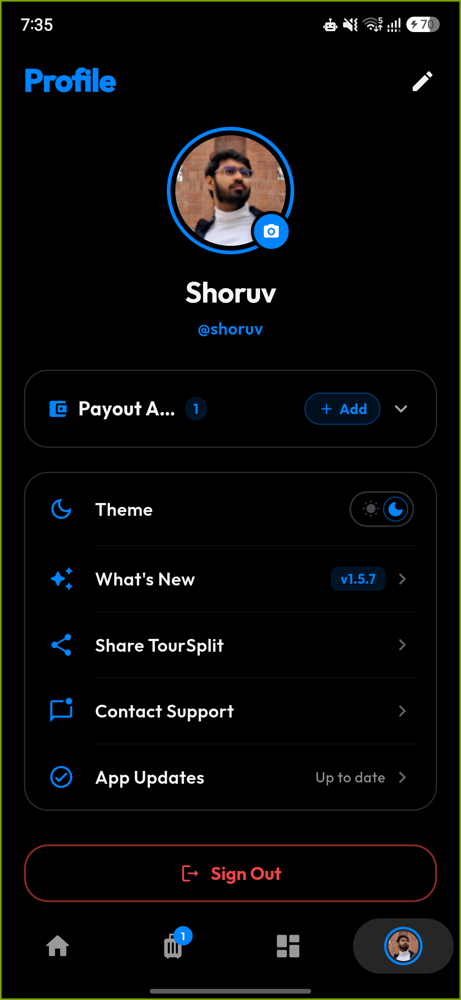 |

 

### Expense Tracking & Attribution

| Sheet Attribution | Cards Attribution | Members Directory | Streamlined Settings |
|:---:|:---:|:---:|:---:|
| 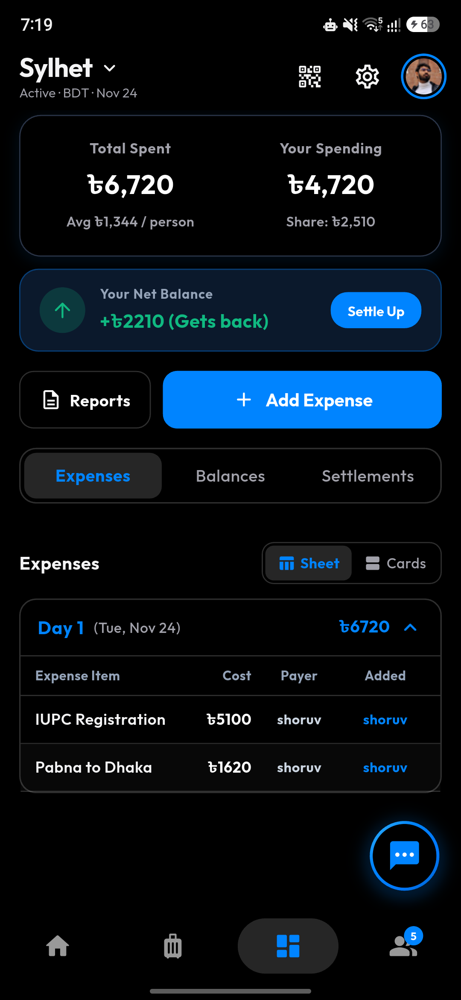 | 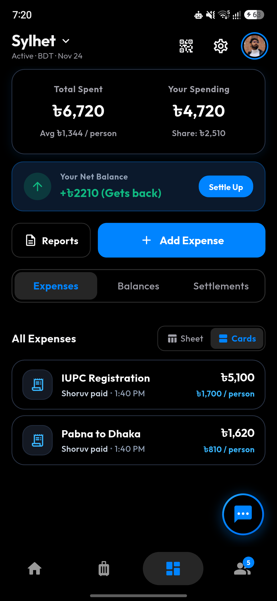 | 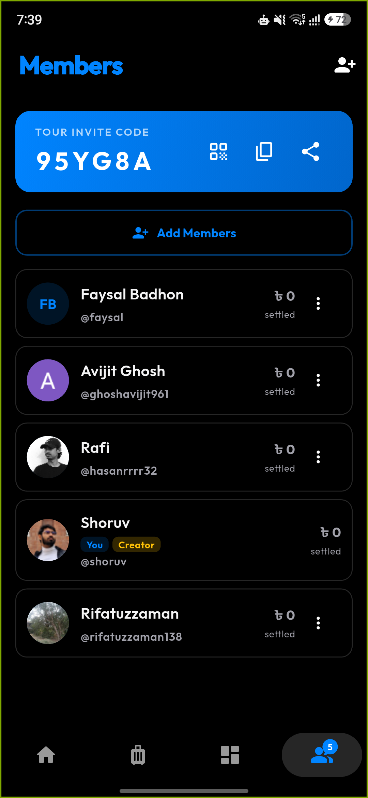 | 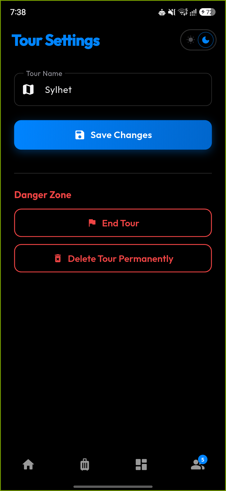 |

 

### Smart Calculations & Collaboration

| In-Line Math Calculator | Live Tour Chat & Mesh | Member Balances | Debt Settlements |
|:---:|:---:|:---:|:---:|
| 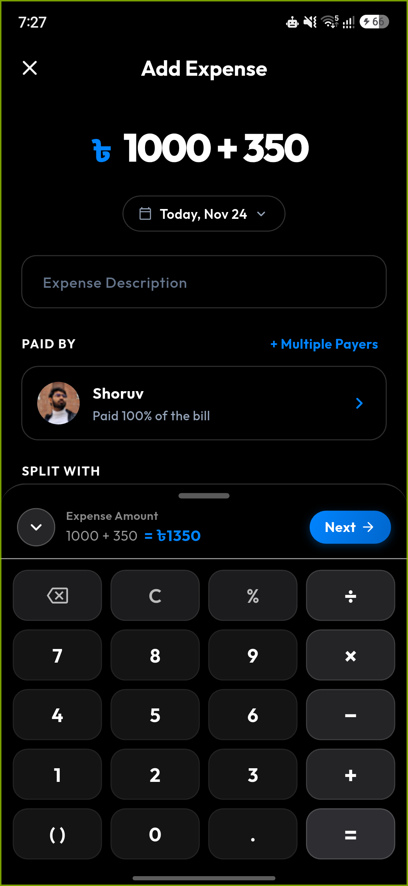 | 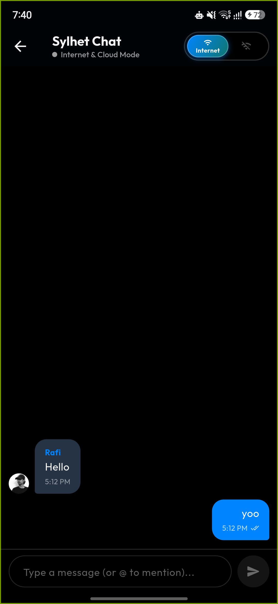 | 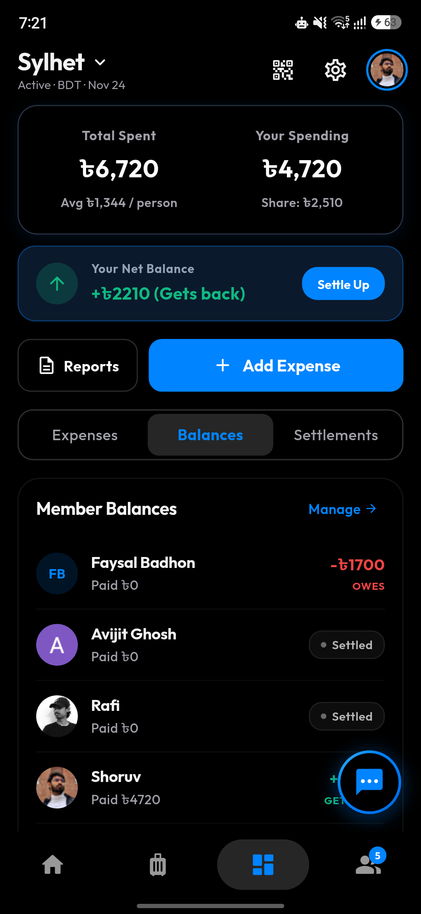 | 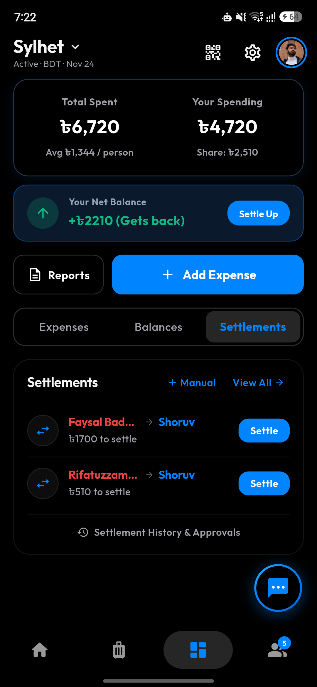 |

 

### Tour Setup, Reports & What's New

| Effortless Tour Setup | What's New Features | Itemized PDF Reports |
|:---:|:---:|:---:|
| 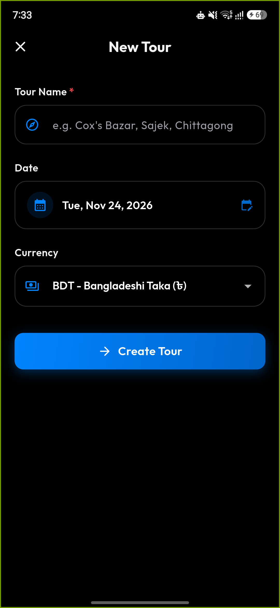 | 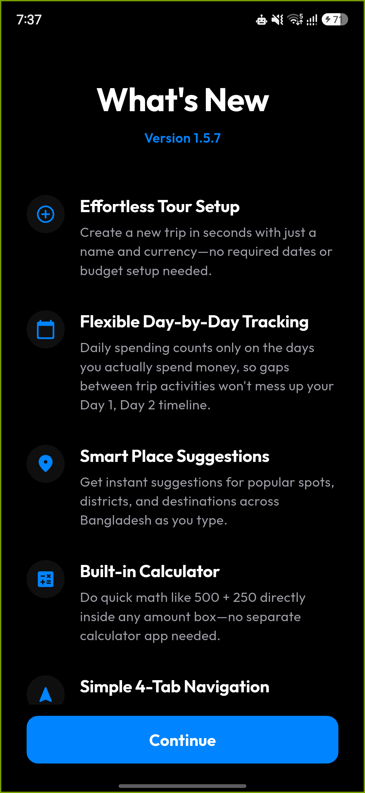 | 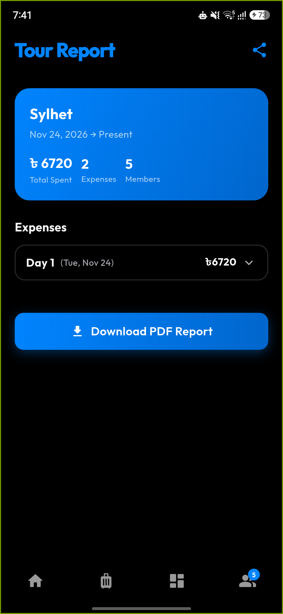 |

---

## Key Features

* **Offline-First & P2P Mesh Sync**: Add expenses, record payments, and coordinate without internet access using local Bluetooth and Wi-Fi Direct mesh synchronization.
* **Real-Time Cloud Sync**: Seamlessly syncs via Firebase Firestore whenever internet is connected.
* **Built-in In-Line Calculator**: Write math expressions directly inside any amount field (e.g. `1000 + 350`) with instant preview calculation.
* **Dual Online & Offline Group Chat**: Integrated chat head and messaging with real-time reactions and offline P2P delivery.
* **Smart Debt Minimization & 1-Tap Settle**: Calculates the exact minimum number of transactions needed to clear all group debts with bank & mobile wallet payout links.
* **Comprehensive Expense Reports**: Export summary statements, day-by-day logs, and PDF receipts.
* **Pure OLED Pitch-Black Mode**: High-contrast, battery-saving dark interface with vibrant electric blue highlights.
* **Built-in Auto Updater**: Seamless in-app OTA updates to keep you on the latest version effortlessly.

---

## Download & Install

1. Go to the [**Latest Releases Page**](https://github.com/shoruvx/TourSplit-App/releases/latest).
2. Download the `TourSplit.apk` file.
3. Tap the downloaded APK to install.
4. Enjoy smooth, hassle-free tour planning!

---

Built by Shoruv

